# LatheCAM — Atelier CAO/FAO de Tournage CNC pour LinuxCNC

[](README.md)
[](README_fr.md)

**LatheCAM** est une application bureautique libre et professionnelle de **CAO/FAO pour le tournage sur tours à commande numérique (CNC)**, développée en Python avec **PySide6 (Qt6)**, **PyVista (VTK)**, **OpenCASCADE (`cadquery-ocp`)**, **`ezdxf`**, **`Shapely` (GEOS)** et **`PyClipper`**.

---

## Galerie d'Écrans & Démonstrations du Flux de Travail

### 1. Simulation Cinématique Interactif du Parcours d'Outil 3D (Plaquette & Porte-Outil) (GIF)
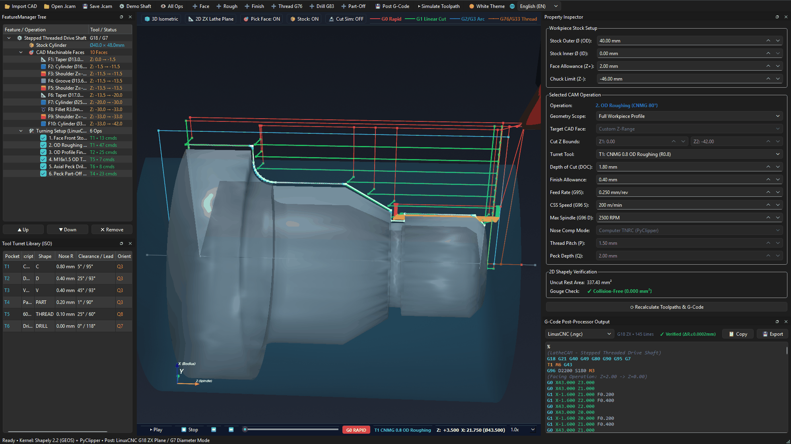

### 2. Éditeur de Bibliothèque d'Outils Tourelle & Plaquettes ISO (Aperçu Plan 2D Vectoriel)
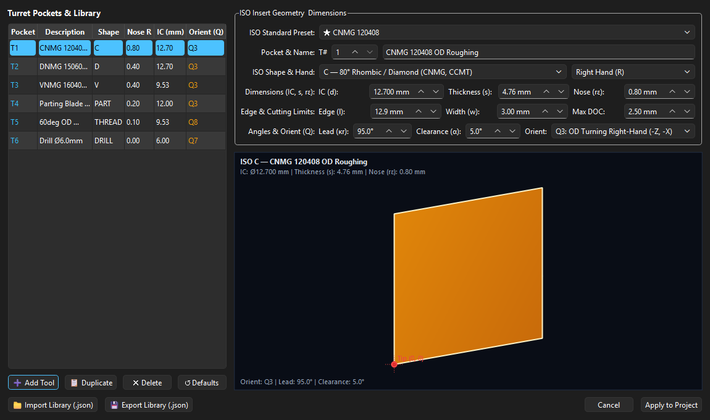

### 3. Sélection Interactive de Faces CAO 3D & Barre d'Assignation d'Opérations
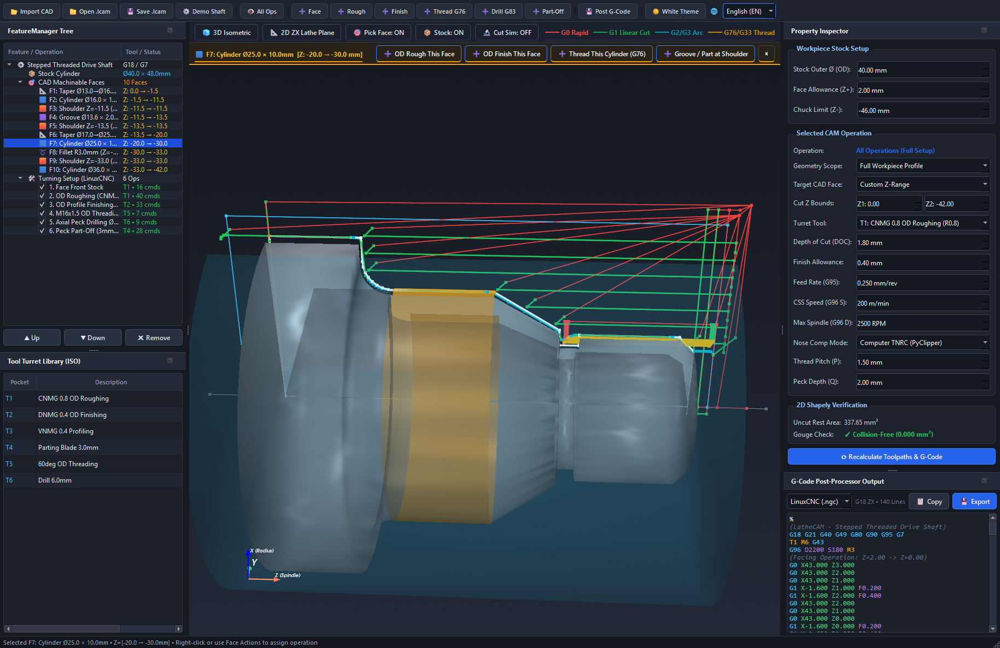

### 4. Vue Rapprochée de la Simulation du Déplacement d'Outil en Temps Réel
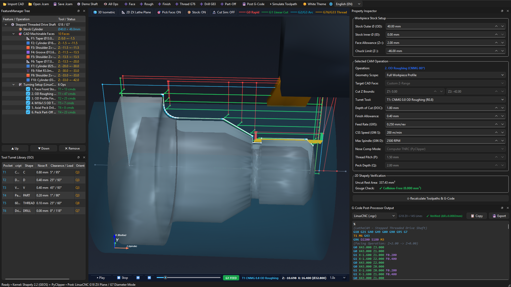

### 5. Ébauche Chariotage 2D Délimitée par Face (`F7: Cylindre Ø25.0 × 10.0mm`)
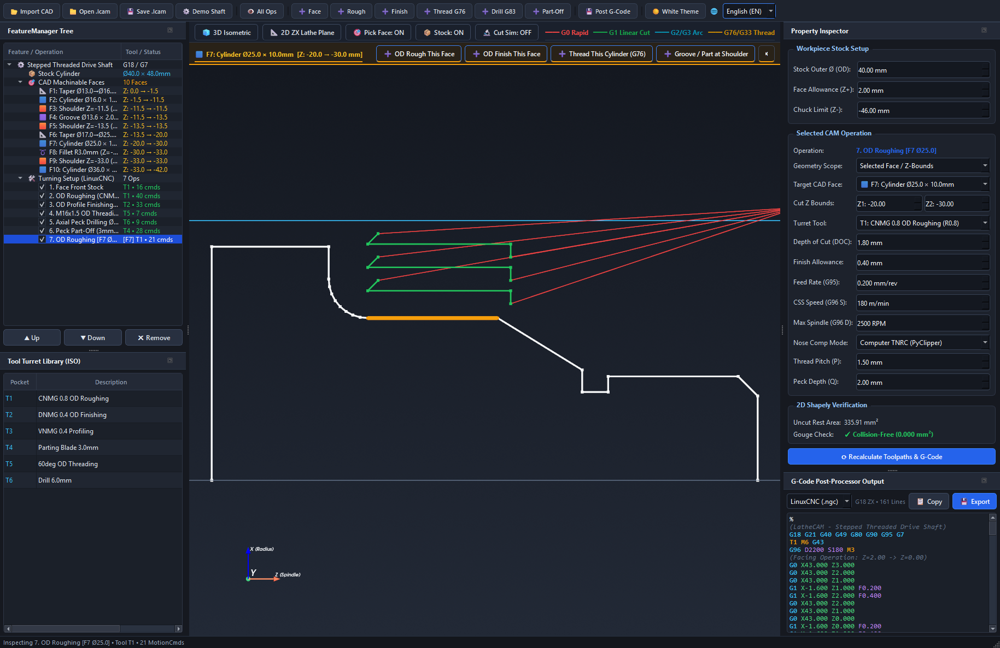

### 6. Flux Complet de Tournage & Enlèvement de Matière 3D (GIF)
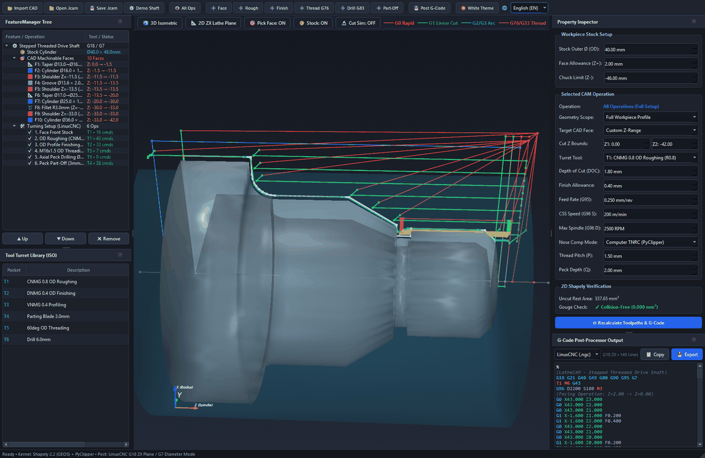

### 7. Vue d'Ensemble de l'Atelier 3D (Thème Sombre)
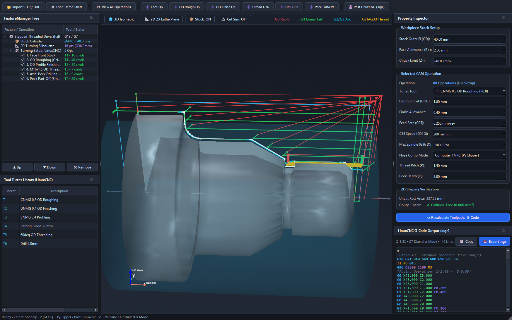

### 8. Thème CAO Clair (Blanc) & Interface Intégralement en Français
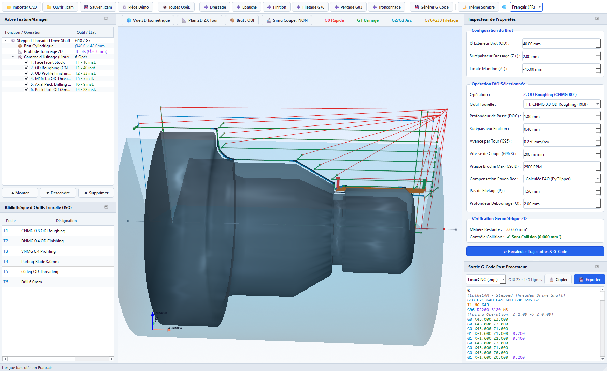

### 9. Plan 2D ZX de Tournage — Passes d'Ébauche avec Dégagements à 45°
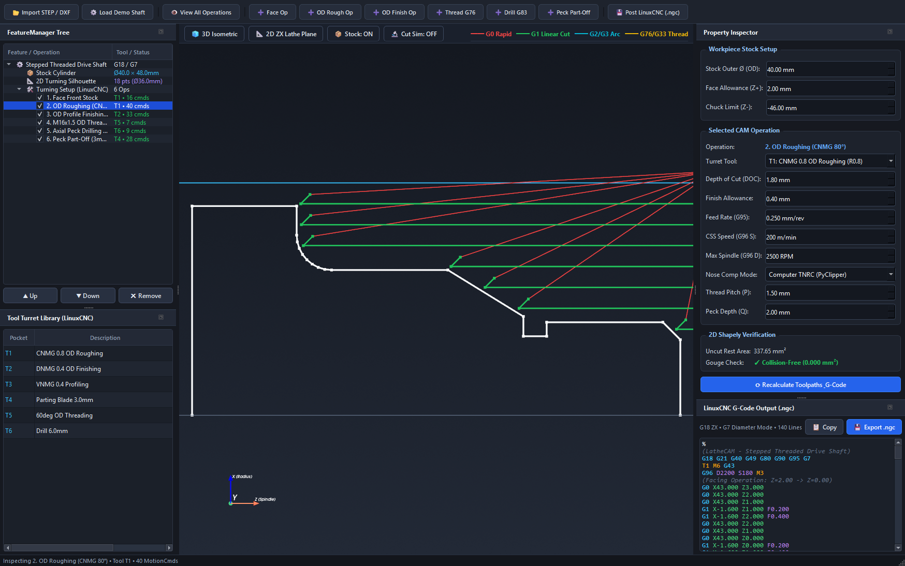

### 10. Finition de Profil 2D avec Compensation de Rayon de Bec (TNRC) & Arcs G2/G3
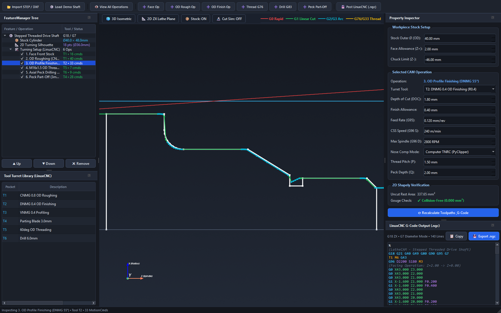

### 11. Simulation 3D d'Enlèvement de Matière & Filetage Extérieur
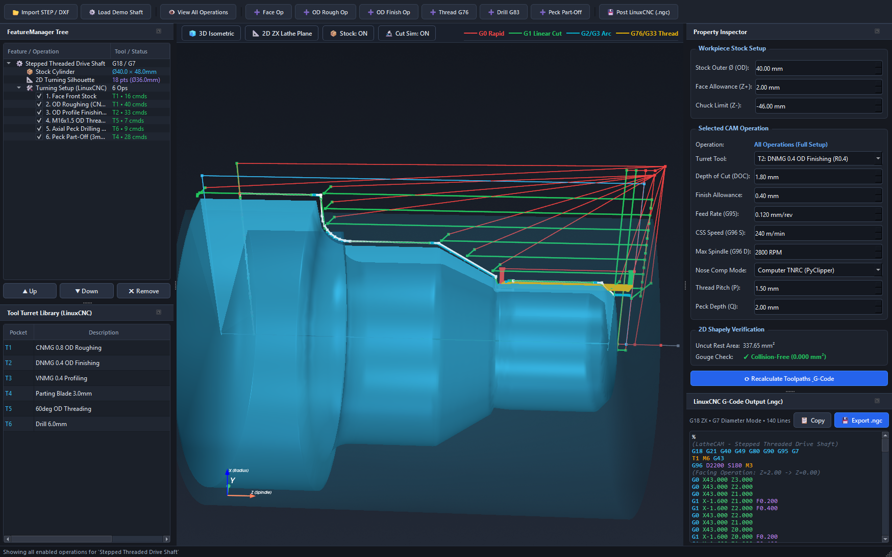

---

## Fonctionnalités Principales & Métier Tournage

### 1. Bibliothèque d'Outils de Tournage & Plaquettes ISO (`src/lathecam/cam/tools.py` & `src/lathecam/ui/dialogs/`)
- **Support des 11 formes standards de plaquettes amovibles ISO :**
  - **C** : Losange 80° (CNMG, CCMT)
  - **D** : Losange 55° (DNMG, DCMT)
  - **V** : Losange 35° pour copiage et profilage fin (VNMG, VBMT)
  - **W** : Trigone 80° à 6 arêtes utiles (WNMG)
  - **T** : Triangulaire 60° (TNMG, TCMT)
  - **S** : Carrée 90° pour surfaçage / chanfreinage lourd (SNMG, SCMT)
  - **R** : Ronde / Pastille bouton (RNMG, RCMT)
  - **K** : Parallélogramme 55° pour copiage spécifique (KNUX)
  - **PART** : Lame à gorge et tronçonnage
  - **THREAD** : Plaquette de filetage 60° (16ER / 16IR)
  - **DRILL** : Foret hélicoïdal et foret à centrer axial
- **Aperçu Plan 2D Vectoriel en Temps Réel :** Rendu précis de la silhouette polygonale de la plaquette, congés de rayon de bec $r_\epsilon$, cercle inscrit théorique en pointillés ($IC$), trou central de fixation et cotes dimensionnelles.
- **Réglage Paramétrique Intégral :** Cercle inscrit ($IC$), épaisseur ($s$), rayon de bec ($r_\epsilon$), longueur d'arête utile ($l$), largeur de coupe ($w$), angle d'attaque ($\kappa_r$), angle de dépouille ($\alpha$), profondeur de passe maximale admissible ($a_p$), sens de coupe (À droite R, À gauche L, Neutre N) et quadrants d'orientation standard (Q1 à Q9).
- **16 Préréglages d'Usine Standards :** Application en 1 clic des plaquettes d'atelier les plus répandues (`CNMG 120408`, `DNMG 150604`, `VNMG 160404`, `WNMG 080408`, `TNMG 160408`, `SNMG 120408`, `RCMT 1204MO`, `KNUX 160405R`, Lames 2mm/3mm, Filetage 16ER, Forets Ø5 et Ø10mm).
- **Gestion Complète de Tourelle & Persistance :** Ajout, duplication, suppression de postes d'outils, réinitialisation aux valeurs usine, import/export JSON et enregistrement automatique dans les fichiers de projet `.lcam`.

### 2. Simulation Cinématique & Relecture Interactive des Trajectoires (`src/lathecam/ui/docks/simulation_dock.py`)
- **Animation de l'Ensemble Plaquette + Porte-Outil :** Déplacement fluide de l'outil 3D réel suivant rigoureusement les trajectoires programmées.
- **Pupitre de Commande de Lecture :** Lecture (Play), Pause, Arrêt (Stop), Pas à pas avant / arrière et barre de défilement temporel interactive.
- **Multiplicateur de Vitesse :** Régulation dynamique de la simulation de $0.1\times$ à $10.0\times$.
- **Affichage Numérique des Axes en Temps Réel :** Coordonnées de l'axe $Z$, cote au rayon $X$, cote au diamètre $\varnothing$, avance courante $F$, opération active et nature du mouvement (G0 Rapide, G1 Usinage, Dégagement).
- **Trace Colorée des Trajectoires :** Visualisation immédiate des passes de coupe (vert), des avances rapides (cyan/rouge) et des retraits (jaune).

### 3. Importation CAO & Analyse Géométrique (`src/lathecam/cad/`)
- **Importeur STEP B-Rep 3D (`step_importer.py`) :**
  - Sectionnement méridien rigoureux sur le plan $Y = 0$ ($X-Z$) via OpenCASCADE `BRepAlgoAPI_Section`.
  - Prise en charge des solides pleins, des arbres étagés, ainsi que des pièces tubulaires et cylindres creux alésés (ID/OD).
  - Réinitialisation et nettoyage automatique des opérations et sélections lors de l'ouverture d'un nouveau modèle CAO.
  - Discrétisation adaptative des surfaces de révolution avec une tolérance de flèche sous les `0.005 mm`.
- **Importeur DXF AutoCAD 2D (`dxf_importer.py`) :** Reconstitution topologique des polylignes fermées, segments `LINE`, `ARC` avec bulge et courbes `SPLINE` dans le demi-plan supérieur ($X \ge 0$).
- **Ajustement d'Arcs Circulaires G2/G3 (`geometry.py`) :** Reconstitution des interpolations circulaires avec calcul précis des centres incrémentaux `(I, K)` sous une tolérance de `0.005 mm`.

### 4. Moteur d'Usinage Tournage Pur Shapely / PyClipper (`src/lathecam/cam/`)
- **Zone d'Ombre & Anti-Talonnement (`shadowing.py`) :** Projection conique et angulaire selon la dépouille de plaquette pour interdire toute plongée non dégagée et protéger les épaulements.
- **Ébauche par Tranchage Booléen (`roughing.py`) :** Calcul par soustraction `Brut - Profil_Pièce`, découpage horizontal le long de l'axe $Z$, ordonnancement des passes de l'avant vers l'arrière et dégagements de sécurité à 45°.
- **Finition de Profil & Rayon de Bec (`finishing.py`) :**
  - Prise en charge de la compensation armoire (`G41`/`G42`) et de la compensation calculée FAO (décalage parallèle PyClipper + déport du bec virtuel selon le quadrant Q1–Q9).
  - Traitement robuste des épaulements verticaux stricts sans génération de polygones dégénérés.
- **Cycles Paramétriques Dédiés (`operations.py`) :**
  - **Dressage de Face :** Balayage en $Z$ avec dépassement de l'axe central à $-R_{\text{bec}}$ pour supprimer tout téton central.
  - **Filetage Extérieur :** Génération du cycle machine LinuxCNC `G76` ou décomposition en passes `G33` à section de copeau constante ($\sqrt{n}$) avec pénétration oblique modifiée à $29.5^\circ$.
  - **Tronçonnage & Gorge :** Pénétration radiale avec temporisations et débourrage de brise-copeaux.
  - **Perçage Axial :** Cycle de perçage avec débourrage `G83` / `G73` à vitesse de rotation constante (`G97`).
- **Contrôle d'Interférence & Matière Résiduelle (`simulator.py`) :** Vérification géométrique de collision et détection de surépaisseurs ou morsures matière.

### 5. Post-Processeurs CNC Rigoureux (`src/lathecam/post/`)
- **Post-Processeur LinuxCNC (`linuxcnc.py`) :**
  - Entête normalisée : `G18 G21 G40 G49 G80 G90 G95 G7`.
  - Formatage strict des commentaires évitant les erreurs de syntaxe de commentaires imbriqués dans LinuxCNC.
  - Compatibilité tours 2 axes sans axe Y (évitement des conflits de plan G18 sur cycles fixes).
  - Gestion des changements d'outils `T{id} M6 G43` et limitation de vitesse broche `G96 D{max_rpm} S{css} M3`.
  - Coordonnées $X$ en mode diamètre `G7` tout en conservant les vecteurs de centre d'arc `I` et `K` en cotes radiales strictes.
- **Post-Processeur Fanuc 0i-TF / ISO (`fanuc.py`) :**
  - Clamp de broche `G50 S{max_rpm}`, appels de correcteurs `T0101`, cycles de filetage `G76` sur deux blocs et retour point de référence `G28`.

---

## Démarrage Rapide

### Installation des Dépendances
```bash
pip install -r requirements.txt
```

### Lancement de l'Application

**Option 1 — Universelle (Toutes plateformes : Windows, Linux, macOS) :**
```powershell
python run.py
```

**Option 2 — Script Windows PowerShell :**
```powershell
.\run.ps1
```

**Option 3 — Double-clic Windows Batch :**
```cmd
run.bat
```

### Lancer la Suite de Tests Automatisés (44 Tests Unitaires)
```bash
python -m pytest -v
```

---

## Programmes G-Code d'Exemple & Vérification

Tous les programmes d'usinage générés sont vérifiés géométriquement par l'outil de contrôle intégré (`verifier.py`) et publiés dans le répertoire [`gcode/`](gcode/) :

- **[`gcode/stepped_shaft_ncviewer.nc`](gcode/stepped_shaft_ncviewer.nc)** *(Recommandé pour [ncviewer.com](https://ncviewer.com) & simulateurs en ligne)* : Coordonnées 1:1 au rayon, plan G18 XZ dédié et décomposition complète des passes de filetage et perçage.
- **[`gcode/stepped_shaft_linuxcnc.ngc`](gcode/stepped_shaft_linuxcnc.ngc)** : Dialecte LinuxCNC avec mode diamètre `G7`, correction de rayon `G42`, cycles `G76` et `G83`.
- **[`gcode/stepped_shaft_fanuc.nc`](gcode/stepped_shaft_fanuc.nc)** : Dialecte Fanuc 0i-TF avec `G50`, `T0101` et cycle de filetage sur deux lignes.
- **[`gcode/stepped_shaft_face_bounded.ngc`](gcode/stepped_shaft_face_bounded.ngc)** : Démonstration d'ébauche sélective restreinte à une face CAO particulière.
