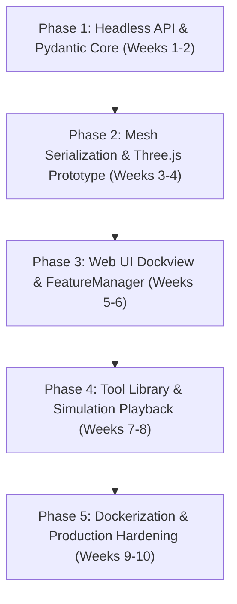

# LatheCAM — Web & Cloud Architecture Migration Plan

This document establishes the comprehensive engineering roadmap for migrating **LatheCAM** from a PySide6 (Qt6) / PyVista (VTK) desktop application into a **cloud-native, web-based CAD/CAM platform** deployable on Linux servers via **Docker & Docker Compose**.

---

## 1. Executive Summary & Migration Objectives

### 1.1 Why Migrate to Web?
- **Zero Client Installation:** Machinists, CNC operators, and engineers can access the software directly from any browser (desktop, tablet, or shop-floor touch terminal) without installing Python, Qt, or C++ binary libraries.
- **Centralized Tool Library & Machine Profiles:** Tool offsets, turret pocket setups, and post-processor configurations remain synchronized across the workshop.
- **Server-Side Compute for Heavy CAD:** Complex 3D B-Rep STEP slicing and heavy boolean roughing computations run on high-performance server hardware.
- **Lightweight, High-Frame-Rate Client Visualization:** Modern browsers with WebGL / WebGPU deliver fluid 60–120 FPS 3D and 2D rendering without server GPU rendering costs.
- **Direct Machine Integration:** Server-based G-code storage can integrate directly with machine controllers (LinuxCNC via `linuxcnc-ethernet` / Mesa, OctoPrint, or network shares).

### 1.2 Core Architectural Philosophy
The desktop LatheCAM codebase was designed with clean decoupling in mind:
- **Core CAM & Geometry Kernel (`src/lathecam/cad/`, `src/lathecam/cam/`, `src/lathecam/post/`):** **Already 100% headless Python and C-accelerated libraries (`shapely`, `pyclipper`, `ezdxf`, `numpy`, `scipy`, `cadquery-ocp`).** None of the math, slicing, or G-code generation depends on PySide6 or Qt.
- **Only the Presentation Layer (`src/lathecam/ui/`):** PySide6 docks, menus, dialogs, and PyVista Qt interactor widgets will be replaced with a modern Web frontend.

---

## 2. Target Web Architecture

```text
┌────────────────────────────────────────────────────────────────────────┐
│                        Web Browser (Client)                            │
│ ┌──────────────────┬─────────────────────────────────┬───────────────┐ │
│ │  FeatureManager  │     3D / 2D WebGL Viewport      │ Property &    │ │
│ │  - Stock / Faces │  - Three.js / React Three Fiber │ Operation     │ │
│ │  - CAM Tree      │  - Revolved Part (Cutaway)      │ Inspector     │ │
│ │  - Turret Dock   │  - 3D Tool Model + Kinematics   │ - DOC, Feeds  │ │
│ │                  │  - Color-Coded Toolpaths        │ - Tool Select │ │
│ └──────────────────┴─────────────────────────────────┴───────────────┘ │
│ ┌──────────────────────────────────┬─────────────────────────────────┐ │
│ │  Interactive Simulation Bar      │  Monaco Editor (G-Code View)    │ │
│ │  Play / Pause / Scrub / Speed    │  Syntax Highlighting & Backplot │ │
│ └──────────────────────────────────┴─────────────────────────────────┘ │
└───────────────────────────────────┬────────────────────────────────────┘
                                    │ HTTPS (REST) + WebSockets
                                    ▼
┌────────────────────────────────────────────────────────────────────────┐
│              Dockerized Application Server (Linux Host)                │
│                                                                        │
│ ┌────────────────────────────────────────────────────────────────────┐ │
│ │             Reverse Proxy & Edge Gateway (Caddy / Nginx)           │ │
│ │ - SSL/TLS Termination, Gzip/Brotli compression, Static Caching     │ │
│ └─────────────────────────────────┬──────────────────────────────────┘ │
│                                   │                                    │
│ ┌─────────────────────────────────▼──────────────────────────────────┐ │
│ │                  FastAPI Application Server (ASGI)                 │ │
│ │ - REST Endpoints: Project, CAD Ingestion, Tool Library, Dialects   │ │
│ │ - WebSockets: Live Kinematic Simulation Streaming & Recalculation  │ │
│ │ - Mesh Serializer: Profile -> glTF / BufferGeometry JSON           │ │
│ └──────────────────┬─────────────────────────────────┬───────────────┘ │
│                    │                                 │                 │
│                    ▼                                 ▼                 │
│ ┌────────────────────────────────────┐ ┌─────────────────────────────┐ │
│ │  Headless CAD Slicing Engine       │ │ Pure Turning CAM Kernel     │ │
│ │  - OpenCASCADE (cadquery-ocp)      │ │ - Shapely 2.0 (GEOS)        │ │
│ │  - ezdxf 2D Spline/Arc Extractor   │ │ - PyClipper Parallel Offset │ │
│ │  - Meridian Contour Decomposition  │ │ - LinuxCNC / Fanuc Post     │ │
│ └────────────────────────────────────┘ └─────────────────────────────┘ │
└────────────────────────────────────────────────────────────────────────┘
```

---

## 3. Technology Stack Selection

| Component | Desktop Implementation | Web Migration Target | Justification |
| :--- | :--- | :--- | :--- |
| **Backend Framework** | Monolithic Python Process | **FastAPI (ASGI) + Uvicorn** | High-throughput async REST + native WebSocket support, automatic OpenAPI/Swagger documentation, and Pydantic v2 validation. |
| **Data Serialization** | Custom `to_dict` / `from_dict` | **Pydantic v2 Models** | Automatic JSON schema generation, type coercion, sub-millisecond serialization speeds. |
| **CAD Ingestion** | OpenCASCADE `cadquery-ocp` + `ezdxf` | **Headless OpenCASCADE + `ezdxf`** | Identical B-Rep slicing and DXF extraction logic; runs headlessly in Linux container without X11 or display server. |
| **Turning Kernel** | `shapely`, `pyclipper`, `scipy` | **Unchanged (Pure Python / C)** | 100% reusable code; already verified across 45 automated unit tests. |
| **Frontend Framework** | PySide6 (Qt6) Widgets | **React 19 + TypeScript + Vite** | Robust component ecosystem, strict type safety, instant HMR development, and wide industrial CAD UI adoption. |
| **3D Rendering** | PyVista (VTK OpenGL window) | **Three.js / React Three Fiber (R3F)** | Client-side hardware WebGL rendering; zero server GPU burden; smooth 60–120 FPS camera control; cross-platform on phones, tablets, and PCs. |
| **2D Geometry Canvas** | Qt `QPainter` | **HTML5 Canvas / Paper.js / SVG** | Used for 2D ZX cross-section, TNRC radius compensation visualization, and ISO insert blueprint preview. |
| **Docking & Windowing** | `QDockWidget` / `QMainWindow` | **Dockview (`dockview-core`)** | Provides identical SolidWorks/Fusion-style dockable, pinnable, floating, and tabbed panels in web browsers. |
| **G-Code Editor** | PySide6 `QPlainTextEdit` | **Monaco Editor (`@monaco-editor/react`)** | The VS Code editor in the browser: native line numbering, custom G-code tokenizer, syntax highlighting, and two-way cursor synchronization with the 3D viewport. |
| **Container Engine** | Local Python virtualenv | **Docker + Docker Compose** | Reproducible builds; pre-packaged OpenCASCADE and C++ libraries; isolated environments. |
| **Edge Proxy** | N/A | **Caddy Server** | Automatic Let's Encrypt HTTPS certificates, HTTP/2 & HTTP/3, and low-latency reverse proxying. |

---

## 4. Component-by-Component Migration Strategy

### 4.1 Backend Architecture (FastAPI)
The existing desktop modules will be wrapped in a RESTful service:

```text
src/
├── lathecam/                    # Existing Core (Reused 100%)
│   ├── cad/                     # STEP & DXF importers
│   ├── cam/                     # Slicing, roughing, finishing, threading, tools
│   ├── models/                  # LatheProject, Stock, OperationNode, TurnedFace
│   └── post/                    # LinuxCNC, Fanuc, NCViewer post-processors
└── lathecam_web/                # NEW Web Layer
    ├── api/                     # FastAPI route routers
    │   ├── cad.py               # STEP/DXF file uploads & contour extraction
    │   ├── operations.py        # Add, reorder, edit CAM operations
    │   ├── tools.py             # ISO insert library & preset CRUD
    │   ├── project.py           # Project state, save/load, recalculate
    │   └── simulation.py        # WebSocket kinematic trajectory stream
    ├── schemas/                 # Pydantic request/response models
    ├── services/                # Business logic & geometry-to-glTF serializers
    └── main.py                  # FastAPI app factory and static asset mounting
```

#### Key API Endpoints:
- `POST /api/cad/upload`: Uploads `.step`, `.stp`, or `.dxf`. Returns normalized contour points, machinable face decomposition, and suggested stock sizing.
- `POST /api/project/recalculate`: Triggers the CAM engine, returns motion commands, gouge checks, and generated G-code.
- `GET /api/project/mesh/part`: Returns revolved 3D workpiece geometry as binary glTF (`.glb`) or compact Float32 vertex/normal arrays.
- `GET /api/project/mesh/stock`: Returns stock cylinder geometry.
- `GET /api/project/gcode?dialect=linuxcnc`: Generates and downloads production-ready `.ngc` file.
- `GET /api/tools/library` & `PUT /api/tools/library`: Tool library management with ISO insert dimension parameterization.
- `WS /api/simulation/ws`: Real-time WebSocket connection for synchronized kinematic playback.

### 4.2 Frontend Architecture (React + Three.js)
The frontend client mirrors the desktop UI layout:

```text
frontend/
├── src/
│   ├── components/
│   │   ├── layout/              # Dockview workspace wrapper
│   │   ├── viewport/
│   │   │   ├── ThreeCanvas.tsx  # Three.js 3D WebGL viewport
│   │   │   ├── RevolvedPart.tsx # 3/4 cutaway workpiece mesh
│   │   │   ├── ToolMesh3D.tsx   # Parametric ISO insert + tool shank
│   │   │   ├── Toolpath3D.tsx   # Color-coded G0/G1/G2/G3/G76 line segments
│   │   │   └── ViewportHUD.tsx  # Iso/2D toggle, face picking, stock visibility
│   │   ├── docks/
│   │   │   ├── FeatureTree.tsx  # Stock, CAD Faces, Operations tree
│   │   │   ├── Properties.tsx   # DOC, speeds, feeds, scope inspector
│   │   │   ├── ToolTurret.tsx   # Pocket table & library launcher
│   │   │   └── GCodeDock.tsx    # Monaco G-code preview with line sync
│   │   ├── dialogs/
│   │   │   ├── ToolEditor.tsx   # ISO Insert Editor modal
│   │   │   └── InsertPreview.tsx# Live 2D SVG/Canvas blueprint preview
│   │   └── playback/
│   │       └── SimToolbar.tsx   # Play, Pause, Step, Scrub, Speed slider
│   ├── stores/                  # Zustand state management
│   │   ├── useProjectStore.ts   # Active operations, stock, and G-code
│   │   ├── useSimStore.ts       # Frame index, speed, playing state
│   │   └── useToolStore.ts      # Turret pocket tool definitions
│   └── api/                     # Axios / Fetch client wrappers
```

### 4.3 3D Mesh Generation & Streaming
To avoid heavy server-side GPU rendering:
1. **Server-Side Revolve:** The backend converts the 2D meridian contour points into a 3D revolved surface with $75^\circ \to 355^\circ$ cutaway using NumPy.
2. **Compact Transmission:** Vertices and triangle indices are sent as raw binary Float32 arrays or compressed `.glb` files (typically under 150 KB for complex shafts).
3. **Client-Side Rendering:** Three.js ingests the `BufferGeometry` directly and renders with physically-based metallic shaders and shadows.

### 4.4 Simulation Playback
- Desktop LatheCAM precomputes the kinematic trajectory list (`MotionCmd` waypoints with interpolated tool center positions).
- In Web LatheCAM, the backend transmits the discrete waypoints (positions, feed rates, motion types).
- The client-side animation loop (`requestAnimationFrame`) handles playback, scrubbing, and speed multipliers entirely locally, resulting in **zero network lag during interactive toolpath scrubbing**.

---

## 5. Dockerfile & Container Architecture

### 5.1 Multi-Stage Production `Dockerfile`
A single, highly optimized multi-stage `Dockerfile` compiles the frontend and packages the headless Python backend:

```dockerfile
# ==============================================================================
# Stage 1: Build Frontend Assets (React + Vite + TypeScript)
# ==============================================================================
FROM node:20-alpine AS frontend-builder
WORKDIR /build

COPY frontend/package.json frontend/package-lock.json ./
RUN npm ci

COPY frontend/ ./
RUN npm run build

# ==============================================================================
# Stage 2: Python Backend with Headless OpenCASCADE & Geometry Stack
# ==============================================================================
FROM python:3.11-slim-bookworm AS production

ENV PYTHONUNBUFFERED=1 \
    PYTHONDONTWRITEBYTECODE=1 \
    DEBIAN_FRONTEND=noninteractive \
    PORT=8000

# Install minimal OS runtime dependencies for OpenCASCADE and VTK (headless)
RUN apt-get update && apt-get install -y --no-install-recommends \
    libgl1-mesa-glx \
    libglib2.0-0 \
    libgomp1 \
    libxrender1 \
    libxext6 \
    ca-certificates \
    curl \
    && rm -rf /var/lib/apt/lists/*

WORKDIR /app

# Install Python requirements
COPY requirements.txt ./
RUN pip install --no-cache-dir --upgrade pip setuptools wheel && \
    pip install --no-cache-dir -r requirements.txt && \
    pip install --no-cache-dir fastapi uvicorn[standard] gunicorn pydantic-settings python-multipart websockets

# Copy Backend Source Code
COPY src/ /app/src/
ENV PYTHONPATH="/app/src"

# Copy Compiled Frontend Assets from Stage 1 into Web Static Directory
COPY --from=frontend-builder /build/dist /app/static

# Create non-privileged user for security
RUN useradd -m -u 1000 latheuser && \
    mkdir -p /app/data /app/uploads && \
    chown -R latheuser:latheuser /app

USER latheuser

EXPOSE 8000

HEALTHCHECK --interval=30s --timeout=5s --start-period=10s --retries=3 \
    CMD curl -f http://localhost:8000/api/health || exit 1

# Launch with production ASGI server
CMD ["uvicorn", "lathecam_web.main:app", "--host", "0.0.0.0", "--port", "8000", "--workers", "2"]
```

### 5.2 Production `docker-compose.yml`

```yaml
version: "3.9"

services:
  lathecam:
    build:
      context: .
      dockerfile: Dockerfile
    image: lathecam:latest
    restart: unless-stopped
    environment:
      - PORT=8000
      - MAX_UPLOAD_SIZE_MB=50
      - ENVIRONMENT=production
    volumes:
      - lathecam_data:/app/data
      - lathecam_uploads:/app/uploads
    networks:
      - lathecam_net
    expose:
      - "8000"

  caddy:
    image: caddy:2-alpine
    restart: unless-stopped
    ports:
      - "80:80"
      - "443:443"
    volumes:
      - ./deploy/Caddyfile:/etc/caddy/Caddyfile:ro
      - caddy_data:/data
      - caddy_config:/config
    depends_on:
      lathecam:
        condition: service_healthy
    networks:
      - lathecam_net

volumes:
  lathecam_data:
  lathecam_uploads:
  caddy_data:
  caddy_config:

networks:
  lathecam_net:
    driver: bridge
```

### 5.3 Edge Gateway Configuration (`deploy/Caddyfile`)
```caddy
{
    email admin@yourdomain.com
}

yourdomain.com {
    encode zstd gzip

    # API and WebSocket proxy
    handle /api/* {
        reverse_proxy lathecam:8000 {
            header_up Host {upstream_hostport}
            header_up X-Forwarded-Proto {scheme}
        }
    }

    # Static UI fallback
    handle {
        reverse_proxy lathecam:8000
    }
}
```

---

## 6. Phased Implementation Roadmap



### Phase 1: Headless Core Validation & FastAPI Foundation (Weeks 1–2)
- [ ] Create `lathecam_web/schemas/` with Pydantic v2 representations of `Stock`, `Contour`, `OperationNode`, `LatheTool`, and `VerificationReport`.
- [ ] Build FastAPI endpoints for project creation, demo shaft loading, and `.lcam` JSON persistence.
- [ ] Wrap `STEPImporter` and `DXFImporter` in multipart upload endpoints.
- [ ] Add Pytest integration tests validating headless API calculation parity with desktop results.

### Phase 2: Mesh Serialization & Three.js 3D Viewport (Weeks 3–4)
- [ ] Write backend geometry serializer producing compact binary arrays (`Float32Array`) for:
  - 3/4 cutaway revolved workpiece surface.
  - Translucent stock cylinder envelope.
  - 3D parametric tool meshes (holder shank + ISO insert).
- [ ] Scaffold React + Vite + TypeScript frontend.
- [ ] Implement Three.js viewport with OrbitControls, CAD lighting, ground shadow, and clipping plane.
- [ ] Implement client-side face raycasting / surface picking to select machinable faces.

### Phase 3: Desktop-Grade Web Layout & CAM Features (Weeks 5–6)
- [ ] Integrate `dockview` for customizable tabbed/floating panels:
  - **FeatureManager Tree:** Workpiece Stock, CAD Faces folder, and Operations list with drag-and-drop reordering.
  - **Properties Inspector:** Dynamic inputs for DOC, finish allowance, feeds/speeds (CSS/RPM), and nose radius compensation mode.
  - **G-Code Output Dock:** Monaco Editor with syntax highlighting, copy, and export buttons.
- [ ] Connect operation editing to `POST /api/project/recalculate` with debounced auto-recalculation.

### Phase 4: ISO Tool Library & Kinematic Simulation (Weeks 7–8)
- [ ] Implement 2D SVG/Canvas `Insert2DPreview` component reproducing the desktop blueprint view ($IC$, $s$, $r_\epsilon$, cutting tip marker).
- [ ] Build Tool Library Editor modal with ISO shape dropdown (all 11 shapes), preset selector, and pocket management.
- [ ] Implement client-side kinematic toolpath playback:
  - Play, Pause, Stop, Step, Scrubbing slider, and Speed controls ($0.1\times \to 10.0\times$).
  - Dynamic coordinate readout ($Z$, $X_{\text{radius}}$, $\varnothing_{\text{dia}}$, Feed, Motion Type).
  - Trajectory color-coding (G0 red, G1 green, G2/G3 cyan, G76 gold).

### Phase 5: Containerization, Testing & Production CI/CD (Weeks 9–10)
- [ ] Finalize multi-stage `Dockerfile` and `docker-compose.yml`.
- [ ] Validate container build in clean Linux environment (Debian / Ubuntu / Alpine).
- [ ] Verify headless OpenCASCADE memory footprint and optimize thread pool workers.
- [ ] Implement GitHub Actions CI/CD pipeline building and publishing Docker images to GitHub Container Registry (GHCR).

---

## 7. Risk Analysis & Mitigation Strategies

| Risk | Impact | Mitigation Strategy |
| :--- | :--- | :--- |
| **OpenCASCADE Container Weight** | Medium (Docker image size ~1.5 GB) | Use multi-stage builds; clean apt caches; provide `requirements-core.txt` fallback if users only need 2D DXF workflows. |
| **High Concurrent Load on Slicing** | High (CPU spike during complex STEP slicing) | Offload heavy B-Rep slicing to Celery / Redis background worker queue; cache sliced contours by SHA-256 hash of the STEP file. |
| **Browser Compatibility & WebGL** | Low (WebGL is ubiquitous) | Enforce standard WebGL 2.0; provide CSS fallback warning for unsupported legacy browsers. |
| **G-Code Safety on Network** | High (Accidental transfer to live machines) | Enforce strict authorization / API tokens; run post-processor verification checks (`verifier.py`) before permitting any file download. |
| **State Desynchronization** | Medium (Multi-user edits) | Use project UUIDs; maintain immutable project revision histories with optimistic locking. |

---

## 8. Summary of Deliverables

Upon completion of this migration, the project will consist of:
1. **A production Docker container** runnable with a single command:
   ```bash
   docker compose up -d
   ```
2. **A responsive web application** accessible at `http://localhost` (or HTTPS via Caddy) providing 100% functional parity with the desktop application:
   - 3D interactive cutaway viewport & 2D ZX plane.
   - 3D STEP & 2D DXF CAD ingestion.
   - Interactive face selection & 1-click operation assignment.
   - ISO Insert Tool Library Editor with live blueprint preview.
   - Real-time kinematic simulation playback with transport controls.
   - G-Code generation (LinuxCNC, Fanuc, NCViewer) with sub-micron arc verification.
